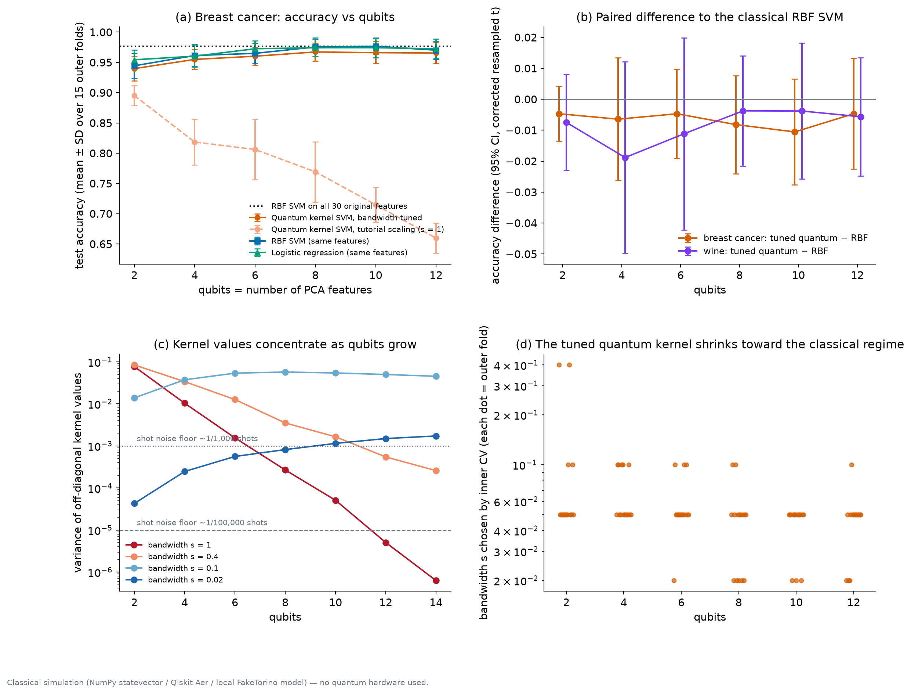
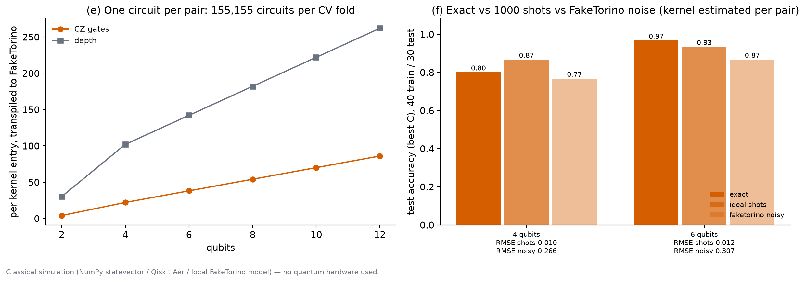
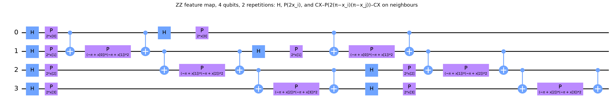
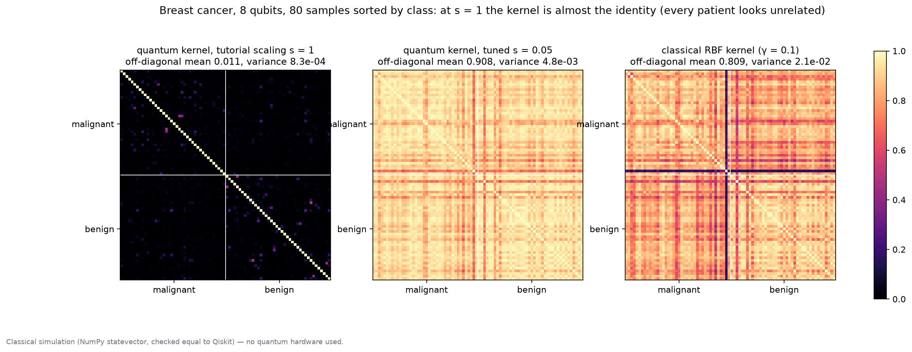

# Quantum kernel reality check

**Qiskit Fall Fest 2026 Warsaw · Track 2: Quantum machine learning**

Does a quantum-kernel SVM beat a classical model on real data when the comparison is fair? We benchmark the fidelity kernel built from Qiskit's ZZ feature map against an RBF SVM and logistic regression. Every model gets the **same features, the same train/test splits and the same nested cross-validation budget**. We then explain the result with two known effects, bandwidth and exponential concentration, and estimate what the kernel would cost on a noisy device.

> **Classical simulation only.** Everything runs on a laptop: NumPy statevectors (tested equal to Qiskit), Qiskit Aer, and the FakeTorino noise model run locally. No quantum hardware and no IBM account were used. **We claim no quantum advantage.**

## Results in one paragraph

With its bandwidth tuned by nested CV, the quantum kernel beats the RBF SVM in **0 of 12** dataset × qubit settings (2–12 qubits, two datasets). The mean differences run from −1.9 to −0.4 accuracy points, and all 12 corrected 95% CIs include zero: tied within noise, never ahead. At the tutorial scaling (s = 1) breast-cancer accuracy falls from 89.5% at 2 qubits to 66.0% at 12, because kernel values concentrate. Their variance shrinks about 2.7× per qubit and falls below the resolution of 1,000 shots from 8 qubits. Cross-validation fixes this by choosing a small bandwidth (median s = 0.05). At such bandwidths the geometric difference to the closest RBF kernel is only g ≈ 1.2–3.1, so a classical kernel already captures what the quantum kernel does. Under the FakeTorino noise model, kernel entries are off by RMSE 0.27–0.31, compared with 0.010–0.012 from 1,000 shots alone. The full breast-cancer dataset needs 155,155 overlap circuits per CV fold. The best model on each dataset is a classical RBF SVM: 97.7% on breast cancer (all 30 features, or 10 PCA features, tied) and 99.8% on wine.

Every number above comes from `artifacts/*.json`. The deck, abstract, pitch script and judge Q&A in `presentation/` are regenerated from those files by `presentation/build.py`, so they cannot drift from the results.





| | |
|---|---|
|  |  |
| The ZZ feature map (4 qubits, 2 reps, linear entanglement) | At s = 1 the 8-qubit kernel is almost the identity; tuned and RBF kernels are not |

## What is in the benchmark

| Piece | What it does |
|---|---|
| **Quantum kernel** | k(x, y) = \|⟨φ(sx)\|φ(sy)⟩\|² with Qiskit's `zz_feature_map` (reps 2, linear entanglement). Batched NumPy statevectors, tested equal to Qiskit's. Compute-uncompute overlap circuits for shot and noise estimates. |
| **Features** | StandardScaler → PCA(n = qubits) → MinMax to [0, π], fitted on each training fold only (a test enforces this). |
| **Splits** | 3 × repeated stratified 5-fold (15 outer folds), identical for every model. |
| **Tuning** | Inner stratified 3-fold CV on each training fold picks C, RBF γ and the quantum bandwidth s. |
| **Models** | Quantum-kernel SVM with tuned s; quantum-kernel SVM at the tutorial s = 1 (C tuned); RBF SVM; logistic regression; RBF SVM on all original features. |
| **Statistics** | Paired per-fold differences with the Nadeau & Bengio (2003) corrected resampled t-test. |
| **Datasets** | Wisconsin breast cancer (569 × 30, malignant vs benign); wine (178 × 13, cultivar 1 vs rest). Both ship with scikit-learn, so no download is needed. |
| **Concentration** | Variance of off-diagonal kernel values vs qubits for s ∈ {1, 0.4, 0.1, 0.02}, and the geometric difference g (Huang et al. 2021) to the closest RBF kernel. Unsupervised: labels unused. |
| **Noise** | 1,000-shot overlap circuits: ideal Aer vs the FakeTorino noise model, run locally. 40 train / 30 test, 4 and 6 qubits. Transpiled CZ count and depth per entry, plus circuits per CV fold. |

## Install

Requires Python 3.12 and [uv](https://docs.astral.sh/uv/).

```bash
uv venv -p 3.12 .venv
uv pip install -p .venv/bin/python -r requirements.lock.txt
uv pip install -p .venv/bin/python -e . --no-deps
source .venv/bin/activate
```

## Run

```bash
python -m qkbench.experiments    # all experiments, ~3 min on a laptop -> artifacts/*.json
python -m qkbench.figures        # main_figure + hardware_figure from the JSON -> figures/
python -m qkbench.visualize      # circuit and kernel visuals -> figures/feature_map_circuit_n4.png, kernel_matrices.png
python presentation/build.py     # deck.html, abstract.md, pitch_script.md, judge_qa.md from the JSON
python -m pytest -q              # correctness tests
python -m streamlit run app/app.py   # interactive explorer
```

The notebook `notebooks/qml_kernels.ipynb` walks through the kernel, the protocol and the diagnostics step by step.

Open `presentation/deck.html` in any browser. It is one self-contained file with the figures embedded. Use the arrow keys or click to move between slides. `presentation/build.py` refuses to write output if any placeholder, `nan`, `inf` or `None` survives, or if the abstract runs past 150 words.

## Layout

```
src/qkbench/
  kernels.py        ZZ-feature-map statevectors, quantum/RBF kernels, overlap circuits, geometric difference
  bench.py          fold-safe preprocessing, nested-CV benchmark, Nadeau–Bengio test, concentration study
  experiments.py    E1 benchmark, E2 concentration, E3 shots/noise -> artifacts/*.json
  figures.py        main_figure, hardware_figure from the JSON
  visualize.py      circuit diagrams and kernel-matrix views
tests/test_core.py  statevectors == Qiskit, kernel validity, overlap circuit == kernel, no leakage, g, NB test
artifacts/          results JSON with provenance (versions, timestamp, platform) and run.log
figures/            PNG + SVG figures
presentation/       build.py and the generated deck.html, abstract.md, pitch_script.md, judge_qa.md
app/                Streamlit explorer
notebooks/          walkthrough notebook
```

## Assumptions

- **Data.** Only the two scikit-learn datasets are used, with binary tasks. Wine is cultivar 1 vs the rest (33.1% positive).
- **Encoding.** PCA to n components, with n = number of qubits (2, 4, 6, 8, 10, 12). Test-fold features are clipped to [−0.5, π + 0.5] after the training-fold MinMax scaling.
- **Grids.** C ∈ {0.1, 1, 10, 100}; RBF γ ∈ {0.01, 0.03, 0.1, 0.3, 1, 3} (divided by the feature count for the full-feature model); bandwidth s ∈ {0.01, 0.02, 0.05, 0.1, 0.2, 0.4, 1}.
- **Concentration study.** 200 random breast-cancer samples, preprocessing fitted on those samples, 2–14 qubits. g is computed with trace-normalised kernels and a 10⁻³ ridge, minimised over the γ grid.
- **Noise study.** One stratified split subsampled to 40 train / 30 test. The bandwidth is the median CV choice at that qubit count. Circuits are transpiled to FakeTorino with optimization_level=1 and a fixed seed; Aer uses a fixed seed. No error mitigation. Accuracy there uses the best C on the test set, so treat it as optimistic and read the kernel RMSE instead.
- **Circuit counts.** One overlap circuit per kernel entry: n_train(n_train − 1)/2 for training and n_test × n_train for testing (455 train / 114 test per fold).

## Honesty and limits

- Everything is classical simulation. FakeTorino is a historical calibration snapshot run locally in Aer. It is not a device.
- **No quantum advantage is claimed.** The tuned quantum kernel never beats the RBF SVM. Its only nominally significant win over any baseline is against logistic regression on wine at 2 qubits (p = 0.045, 1 of 12 uncorrected tests), and the RBF SVM beats logistic regression there too.
- We use two small tabular datasets, one feature map, and no trainable, projected or problem-tailored kernels. Another embedding or another dataset could behave differently. The benchmark is built so you can test that.
- PCA discards information. The hyperparameter grids are finite. We report 24 paired tests without multiplicity correction.
- The noise study uses one small split, two qubit counts and one noise model.

## Related work (cited by author and year)

Havlíček et al. 2019 (ZZ feature map / quantum kernel estimation); Huang et al. 2021 (power of data, geometric difference); Shaydulin & Wild 2022 (bandwidth in quantum kernels); Thanasilp et al. 2022 (exponential concentration of quantum kernels); Nadeau & Bengio 2003 (corrected resampled t-test).

## License

MIT. See [LICENSE](LICENSE). © 2026 warsaw-qml-kernels contributors.
